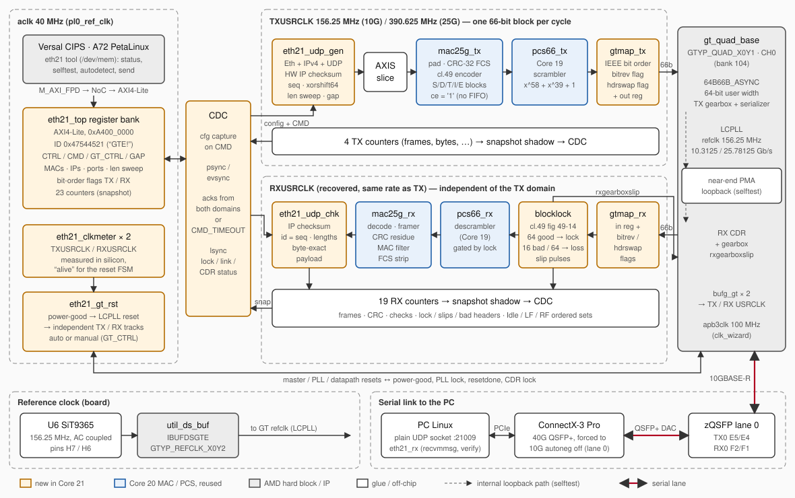

# HERCOSSNUX Core 21 — MAC_10G (10G Ethernet over a real GTYP, 25G-capable)

The [Core 20 MAC](../MAC_25G/) and its 64B/66B PCS, taken off the fabric
loopback and put on a **real serial transceiver**: lane 0 of the Trenz
**TE0950** zQSFP (AMD Versal `xcve2302-sfva784-1LP-e-S`, GTYP bank 104). A
hardware **IPv4/UDP generator** fills the link with frames that a normal Linux
PC receives with a plain UDP socket, and a C receiver on the PC verifies every
packet.

| Build | Line rate | GT user clock | Link partner |
|-------|-----------|---------------|--------------|
| `10` | 10.3125 Gb/s (10GBASE-R) | 156.25 MHz | Mellanox ConnectX-3 Pro (QSFP+, forced to 10G = lane 0) over a QSFP+ DAC |
| `25` | 25.78125 Gb/s (25GBASE-R) | 390.625 MHz | GTYP near-end PMA loopback (the ConnectX-3 Pro has no 25G mode) |

> **Status: SILICON PASS at 10.3125 Gb/s to a Linux PC.** The TE0950 GTYP
> drives a Mellanox ConnectX-3 Pro over a 3 m QSFP+ DAC; a plain UDP socket on
> the PC receives and checks the hardware-generated frames:
>
> | Test | Result |
> |------|--------|
> | 1 000 000 frames, every payload byte verified on the PC | 1 000 000 / 1 000 000 good, 0 lost, 0 out of order |
> | 60 s continuous at line rate (`--cont`) | **48 913 739 sent = 48 913 739 received**, 0 lost, 0 bad, `TX_UNDERRUN 0` |
> | Rate (1472-byte payload, 1538 bytes on the wire) | **809.6 kpps**, 9.53 Gb/s UDP payload, 9.83 Gb/s L2+FCS, **9.96 Gb/s on the wire (99.6 % of 10 Gb/s)** |
> | Link quality, board → PC | 0 CRC errors at the NIC over 97.8 M frames (1.2·10¹² bits, BER < 2.5·10⁻¹² at 95 %) |
> | Link quality, PC → board | 193 M idle blocks from the NIC during a burst: 0 bad sync headers, 0 slips, 0 lock losses |
>
> The real GT bit order — the one thing a loopback cannot prove — is the
> default (`tx_rev = tx_swap = rx_rev = rx_swap = 0`): the IEEE map of
> `eth21_gtmap` was right first time, and `autodetect` is not needed.
>
> **Also: SILICON PASS in GTYP near-end PMA loopback.** `eth21 selftest` sent 100 000 IPv4/UDP frames (78 550 000 bytes)
> through the MAC, the 64B/66B PCS and a real GTYP channel (serializer, CDR,
> 64B66B gearbox): all 18 checked counters match the prediction exactly, the
> injected FCS error is caught once, 0 bad sync headers, 0 slips, 0 lock
> losses, **9.71 Gb/s** L2+FCS (≈ 97.5 % of the 10.3125 Gb/s line, the rest is
> preamble/IPG and 66-bit block alignment). User clocks measured on silicon:
> TXUSRCLK 156.251 MHz, RXUSRCLK 156.250 MHz. Implementation: WNS +1.903 ns,
> WHS +0.018 ns, GT placed at `GTYP_QUAD_X0Y1`.
>
> **Pending:** the 25G build (PMA loopback only: the ConnectX-3 Pro has no
> 25G mode) and a bitstream with the fixed reset sequencer (the one on the
> board needs `devmem 0xA4000014 32 0x31`, see section 5). Verification: six layers (38 GHDL runs, 21/21 RTL mutations detected)
> against an **independent oracle written from IEEE 802.3 cl.49 and RFC
> 791/768**. Bugs found and fixed: two by an independent review (length-sweep
> wrap, RX failures restarting the TX) and **one by silicon** — the reset
> sequencer waited for the LCPLL lock while holding the GT master resets, but
> on Versal the GT's own sequencer only starts the PLL once they are released
> (deadlock in `PLLWAIT`); now both layer 1D and layer 4 model that behaviour
> and the old sequencer fails 5 tests.



---

## 1. What it adds to Core 20

* **GT integration** — `gt_quad_base` in `64B66B_ASYNC` mode, 64-bit user
  width: the GT does the 66↔64 gearbox, the fabric sees one 66-bit block per
  user-clock cycle (exactly the `GEARBOX=false` interface Core 20 closed at
  390.625 MHz). Refclk: the on-board 156.25 MHz oscillator (U6 → H7/H6 =
  `GTYP_REFCLK_X0Y2`).
* **Block lock** (`eth21_blocklock`, cl.49 fig. 49-14): 64 valid sync
  headers to lock, 16 invalid in a 64-block window to lose it, one-cycle
  `rxgearboxslip` pulses with a settling wait.
* **IEEE bit order made explicit** (`eth21_gtmap`): Core 19/20 store the sync
  header with the opposite bit convention to fig. 49-7; the map puts header
  bit 0 and payload bit 0 first on the wire. Because the exact transmission
  order of the GTYP gearbox cannot be guaranteed from the documentation and
  a loopback cannot detect it, **bit-reverse and header-swap are run-time
  register flags** (TX and RX separately).
* **IPv4/UDP generator** (`eth21_udp_gen`): Ethernet + IPv4 (hardware
  checksum, DF, TTL 64) + UDP (checksum 0), payload = `seq`, `~seq`, then a
  xorshift64 stream seeded by `seq`; payload 18..1472 bytes (60..1514-byte
  frames), length sweep, `count` or continuous, inter-frame **gap** for rate
  control. The next frame's checksum is computed while the current one is
  sent, so there are no dead cycles between frames.
* **Byte-exact checker** (`eth21_udp_chk`) for the loopback selftest.
* **GT reset sequencer** (`eth21_gt_rst`): power-good → PLL → independent
  TX and RX tracks (master reset, wait for the user clock to run, userrdy,
  reset-done, timeouts). An RX that never finishes (no cable) does not touch
  the TX or the PLL. A manual mode exposes every reset pin in a register.
* **Link diagnosis**: user-clock frequency meters, idle / Local-Fault /
  Remote-Fault ordered-set counters (block types `0x4B`, `0x2D`, `0x55`),
  slips, bad sync headers, lock losses.

## 2. Repository layout

```
rtl/      eth21_pkg  eth21_udp_gen  eth21_udp_chk  eth21_blocklock  eth21_gtmap
          eth21_txpath  eth21_rxpath  eth21_gt_rst  eth21_clkmeter  eth21_top
          eth21_bd_wrap.v.tpl   (Verilog BD wrapper template, X_INTERFACE_INFO)
          + Core 20: mac25g_tx/rx/pcs66/sync/pkg/crc_pkg, Core 19: pcs_scrambler
tb/       layer testbenches + eth21_gt_model (GTYP 64B66B_ASYNC channel model
          with bit offset, slip latency, bit order, error injection, file input)
oracle/   eth21_oracle.py (independent model), check_tb.py (TB I/O checks)
sim/      run_layers.sh (full regression), run_mutations.py
vivado/   gen_eth_bd_tcl.sh, build_eth_soc.tcl, eth21_gt.xdc
ps/       eth21.c + eth21.bb (board tool and PetaLinux recipe)
pc/       setup_pc.sh, eth21_rx.c (PC side)
doc/      architecture.svg, register_map.md
```

## 3. Verification

`bash sim/run_layers.sh` (GHDL ≥ 4, Python 3) — **38 PASS / 0 FAIL**:

| Layer | What is checked |
|-------|-----------------|
| 1A | generator vs oracle byte for byte: 8 configurations (sweeps, fixed min/max, out-of-range lengths, step 576 and 2047, random backpressure, gap) + IP addresses that force a carry in the second checksum fold + measured inter-frame gap + continuous mode cut by STOP |
| 1B | checker with good, mutated, truncated, `tuser` and out-of-sequence frames, an IPv4 id ≠ seq with a *correct* checksum, with and without valid gaps |
| 1C | block-lock thresholds: 63 vs 64, 15 vs 16 bad headers per window, window restart, slip pulse and wait |
| 1D | GT reset sequencer: normal start; RX never done (TX and PLL untouched, RX retried); PLL lock loss (full restart and recovery); TX user clock dead (RX unaffected) |
| 2 | TX → channel model → RX at line rate in all four GT bit orders and random bit offsets; CRC injection; lock loss and relock; 60 minimum and 10 maximum frames; **the TX wire stream is decoded by the oracle's IEEE decoder** (block lock, descrambler, `/S/`/`/T/`, FCS via `zlib.crc32`) and every frame validated field by field |
| 3 | RX fed oracle-encoded IEEE streams: 40/40 frames in all four GT bit orders with matching flags; with wrong flags lock is reached but **0 frames and `RX_PROTO` > 0** (the autodetect signature); Local/Remote Fault ordered sets in all three block formats counted exactly; a stream with no valid sync header never locks and the MAC sees no block |
| 4 | whole core through AXI4-Lite: GT reset handshake, lock, burst, snapshot, all 23 counters (vs oracle and consistency), CRC injection, clock meter, AXI response monitor; RX held in reset: TX keeps working, `CMD_TIMEOUT` raised, per-domain snapshot |

`python3 sim/run_mutations.py` runs 21 RTL mutations — **21/21 detected** (header fields, checksum
fold, sweep wrap, tkeep, gap, checker checks, lock thresholds, bit maps,
fault counters, reset-track coupling, user-clock gating, counter map, CMD
handshake, clock meter); the regression must fail on every one.

## 4. Build

```bash
cd ~/vhdl_repo/IP_Cores/MAC_10G
bash sim/run_layers.sh                     # 38 PASS
bash vivado/gen_eth_bd_tcl.sh              # BD from Core 20 (CIPS/NoC/DDR untouched)
vivado -mode batch -source vivado/build_eth_soc.tcl -tclargs 10 bd   # BD + validate only
vivado -mode batch -source vivado/build_eth_soc.tcl -tclargs 10      # full 10G build
vivado -mode batch -source vivado/build_eth_soc.tcl -tclargs 25      # full 25G build
```

Outputs: `vivado/eth_soc_<rate>.pdi`, `petalinux_<rate>/eth_soc_<rate>.xsa`,
timing / clock / CDC / utilisation reports in `vivado/`.

## 5. Bring-up

**Board** (PetaLinux with the `eth21` recipe from `ps/`):

```bash
eth21 status        # GT: powergood, PLL lock, tx/rx ready; TXUSRCLK ≈ 156.250 MHz
eth21 selftest      # near-end PMA loopback, 100 000 frames, FCS error injected once
```

Expected `selftest` (deterministic, both rates): `TX_FRAMES 100000`,
`TX_BYTES 78550000`, `RX_OK 99999`, `RX_BYTES 78549936`, `RX_CRC_ERR 1`,
`CHK_OK 99999`, `CHK_RXERR 1`, everything else 0 → `SELFTEST PASS`.

With the bitstream built before the reset-sequencer fix, release the GT by
hand first (the old sequencer waits in `PLLWAIT`), then pulse the RX reset
once the NIC is up:

```bash
devmem 0xA4000014 32 0x31              # manual GT control: master resets released
devmem 0xA4000014 32 0x39; devmem 0xA4000014 32 0x31   # RX datapath reset pulse
eth21 status                           # block_lock=1 link_up=1 once the NIC transmits
```

**PC** (ConnectX-3 Pro, QSFP+ DAC to the TE0950 zQSFP):

```bash
sudo bash pc/setup_pc.sh <if>          # 10G forced (10000baseCR, lane 0), 192.168.21.1/24, UFW,
                                       # buffers, RX IRQs on CPU 2, governor performance; prints the NIC MAC
gcc -O2 -o eth21_rx pc/eth21_rx.c
taskset -c 6 ./eth21_rx -p 21009       # add -q to check only the sequence
```

`ethtool <if>` shows `Speed: 10000Mb/s`, `Link detected: yes` as soon as the
GT is out of reset: the NIC block-locks on the FPGA's idles.

**Board → PC:**

```bash
eth21 send --peer-mac <NIC MAC> --count 1000000
eth21 send --peer-mac <NIC MAC> --cont           # line rate; 'eth21 stop', then 'eth21 counters'
eth21 send --peer-mac <NIC MAC> --cont --gap 200 # throttled
eth21 autodetect                       # only if a link partner needs another bit order
```

`eth21_rx` prints kpps, payload and wire Gb/s, and counts good, bad, lost,
out-of-order packets and burst restarts (a new burst restarts the sequence at
0); `PC RX PASS` at the end when nothing is lost. Compare its `recibidas` with
`TX_FRAMES` on the board: lost packets at the tail of a burst are invisible to
the sequence check.

**Where PC-side losses come from** (all seen on this setup, none of them on
the link):

| Symptom | Counter | Cause | Fix |
|---------|---------|-------|-----|
| ~1.5 % lost, `bad = 0` | `netstat -su`: *packet receive errors* | full payload check in one thread, process moved between cores | `taskset`, or `-q` |
| ~1·10⁻⁵ lost, `bad = 0` | `ethtool -S`: `rx_fifo_errors` | RX IRQ on a shared/sleeping hyper-thread, NIC FIFO overflows | IRQs on their own P-core + governor `performance` (done by `setup_pc.sh`) |
| frames bad | `ethtool -S`: `rx_crc_errors` | link errors | never seen |

## 6. Risks and what is not proven yet

* ~~**GT bit order**~~ — **settled on silicon**: the default (header bit 0
  and data bit 0 first, all flags 0) is what a ConnectX-3 Pro expects.
  `autodetect` stays for other link partners.
* ~~**ConnectX-3 Pro at 10G on a QSFP+ DAC**~~ — **works**: with firmware
  2.43.7028, `ethtool -s <if> speed 10000 autoneg off` makes the NIC
  advertise `10000baseCR/Full` on lane 0 of a plain QSFP+ DAC (Mellanox
  MC2207128-003); no QSA adapter needed.
* **QSFP management pins** (ModSelL/ResetL/LPMode) are driven by the board's
  Artix; irrelevant for a passive DAC, relevant for optics.
* **The 25G build is validated only in near-end PMA loopback**: this proves
  serializer, CDR, gearbox and PCS at 25.78125 Gb/s, but not the channel.
* **Timing at 390.625 MHz** (25G) is not known yet; the new generator and
  checker were written with the Core 20 lessons (staged sums, one-hot word
  flags, precomputed compares), but only the implementation will tell.
* **Not in v1**: hi-BER monitor, fault response in the TX (we count LF/RF
  but always send idles/data), RS-FEC, auto-negotiation/link training,
  PC → FPGA traffic beyond counting (no ARP/ICMP).
* **PC → FPGA traffic** is only counted (idles, LF/RF, blocks, sync
  headers); frames from the PC reach the RX MAC but there is no ARP/ICMP.
* The PC receiver verifies every payload byte in one thread; at line rate
  (810 kpps) that is close to the limit of one core. The 60 s line-rate run
  was done with `-q` (sequence only); the full byte check ran on 1 M frames
  (0 lost) and on 61 M frames of continuous traffic with 0 bad payloads
  (before the PC tuning, with PC-side drops).

## 7. Register map

See [doc/register_map.md](doc/register_map.md).

MIT License.
