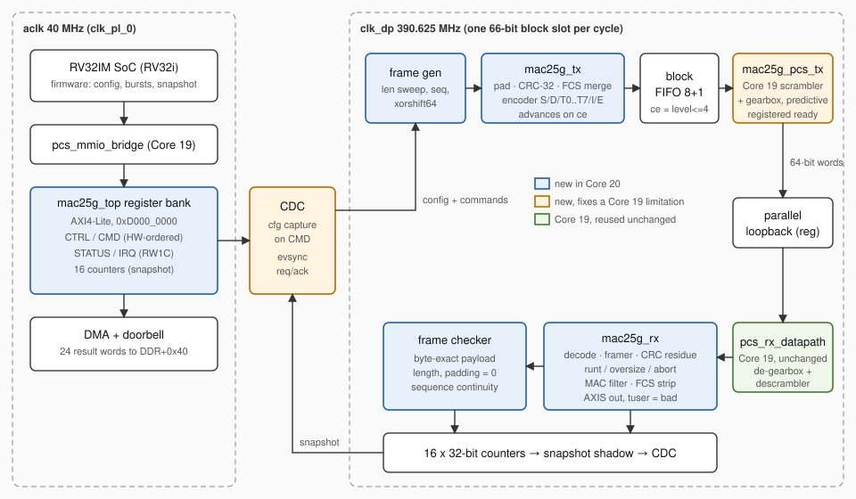

# HERCOSSNUX Core 20 — MAC 25G (IEEE 802.3 clause 49)

A **25 Gb/s Ethernet MAC with 64B/66B block encoding**, written in VHDL-2008,
sitting on top of the [Core 19 PCS](../PCS_25G/) and driven by the family's
RV32IM soft core on the Trenz **TE0950** (AMD Versal `xcve2302-sfva784-1LP-e-S`).

Core 19 proved the physical coding sublayer with PRBS31. Core 20 puts real
Ethernet frames through it: preamble/SFD, padding, CRC-32 FCS, clause-49
start/data/terminate/idle/error blocks, inter-packet gap, and on the receive
side block decoding, FCS residue check, runt/oversize/abort detection, MAC
filtering and FCS stripping — all at one 66-bit block slot per 390.625 MHz
cycle.

> **Status: simulation-validated, timing closure in progress, silicon
> pending.** Five verification layers (21 GHDL runs) match the Python oracle
> bit for bit, including the real compiled firmware running on the real RV32
> of this repository; 27/27 RTL mutations are detected, and the core went
> through an independent review whose findings are fixed and covered by
> tests. The **first implementation did not close at 390.625 MHz (WNS −1.399
> ns)**; the RTL has been reworked for the paths it reported (see
> [section 8](#8-resources-and-timing)) and the new implementation is
> pending. The silicon result is fully
> predicted in advance: `L5 SILICON PASS` requires the 23 deterministic words
> listed in [section 7](#7-silicon-bring-up), FNV signature **`0x446C2628`**.



---

## 1. Feature set (frozen scope v1)

**TX** (`mac25g_tx`)
- AXI-Stream 64-bit input (`tdata`/`tkeep`/`tlast`), one block per clock-enable
- padding to 60 bytes, **CRC-32 FCS** (reflected 0xEDB88320, anchored to zlib)
- clause-49 encoding: `/S/` in lane 0 (`0x78` + preamble + SFD), data blocks,
  `/T0/`…`/T7/` (`0x87 0x99 0xAA 0xB4 0xCC 0xD2 0xE1 0xFF`), idle `0x1E`
- inter-packet gap **≥ 12 characters for every frame length** (fixed two-slot
  rule, proven for all residues mod 8)
- source underrun mid-frame → `/E/` block + `TX_UNDERRUN`
- deterministic single-bit error injection

**RX** (`mac25g_rx`)
- block classification, frame assembly, **FCS check by residue** `0xDEBB20E3`
- runt (< 64 B), oversize (> 1522 B, VLAN-sized frames accepted), abort on
  `/I/`, `/S/`, `/E/` or unsupported blocks mid-frame
- MAC filter: own unicast, broadcast, promiscuous
- **FCS stripping**; AXI-Stream output with `tuser = 1` on bad frames
- one exclusive counter per frame, protocol-event counter, `LINK_UP`
  (64 consecutive blocks without a protocol error)

**Line-rate PCS TX** (`mac25g_pcs_tx`) — see [section 3](#3-what-core-20-found-in-core-19).

**Self-test plane**: frame generator (length sweep, sequence numbers, xorshift64
payload) and a frame **checker** that verifies every delivered byte, the
padding, the length and the sequence continuity — independent of the CRC.

**Explicitly out of scope for v1**: deficit idle count (DIC) and `/S/` in lane
4 (`0x33`/`0x66`) — RX counts them as protocol events; pause/PFC; RS-FEC
(clause 108); PTP timestamps; serial transceivers (validation is in parallel
fabric loopback, as in Core 19).

## 2. Performance

| Metric | Value | Source |
|--------|-------|--------|
| MAC slot efficiency (burst of 100 000 frames, 20–1514 B) | **97.03 %** of block slots carry L2+FCS | oracle, = RTL in sim |
| L2+FCS throughput on a real 25GBASE-R lane | **24.26 Gb/s** (802.3 ideal for the same mix: 24.36 Gb/s → **99.6 %** of ideal) | oracle |
| L2+FCS throughput of the default build (`GEARBOX=false`, one 66-bit block per cycle) | **24.13 Gb/s** measured in layer 5 for its 64-frame mix (5351 cycles for 5353 block slots: line rate) | GHDL layer 5 |
| Same, with the Core 19 fabric gearboxes (`GEARBOX=true`) | 23.52 Gb/s theory (32 blocks per 33 cycles) | oracle + GHDL layer 3 |

With the fabric gearboxes the bench runs at 25.0 Gb/s instead of 25.78125 —
see the second finding below; the default build avoids them.

## 3. What Core 20 found in Core 19

Building a frame MAC on top of the PCS exposed one real limitation and two
points to settle before a real transceiver, none visible to Core 19's PRBS
self-test. **Core 19 has not been modified**; Core 20 works around (1) and
documents (2) and (3).

1. **`pcs_tx_datapath` accepts 31 blocks per 33 cycles, not 32.** When the
   gearbox drops `ready`, the block already in the scrambler goes to the skid
   register, and `in_ready` stays low on the *next* cycle as well while the
   skid drains: two lost slots per gearbox period. Measured in GHDL with
   `in_valid` always high: **3 106 blocks and 3 203 output words in 3 300
   cycles**. In loopback this is invisible; a real serial PMA needs a 64-bit
   word **every** cycle and would underflow about once every 34 cycles.
   `mac25g_pcs_tx` reuses the Core 19 scrambler and gearbox unchanged and adds a
   **predictive, registered `ready`** (an exact copy of the gearbox fill level,
   one cycle ahead): 3 200 blocks / 3 300 words, and a **bit-identical** output
   word stream versus Core 19 (`tb_mac_pcs_tx`, with and without source gaps).
2. **Clocking note — a 64-bit gearbox at 390.625 MHz is a 25.0 Gb/s serial
   equivalent, not 25.78125.** Not a defect of the Core 19 logic, but it
   matters for the claim "true 25G line rate". 390.625 MHz is the 25GBASE-R *block* rate only if each cycle
   carries a full 66-bit block (GT internal gearbox). With a fabric 66→64
   gearbox emitting one 64-bit word per cycle, 32 blocks per 33 cycles flow,
   i.e. 25.0 Gb/s; a true 25.78125 Gb/s lane needs 402.83 MHz on that
   interface. The MAC itself is rate-agnostic (it advances on a clock-enable).
   **The default build therefore uses `GEARBOX=false`**: a 66-bit block per
   cycle through the Core 19 scrambler, exactly what a GT with its internal
   64B/66B gearbox presents, i.e. true 25.78125 Gb/s at 390.625 MHz. This
   also removed the Core 19 gearboxes from the critical path (section 8).
   `GEARBOX=true` keeps the fabric-gearbox path and is still verified in
   simulation (layers 1B and 3).
3. **Sync-header polarity (to verify before any real PMA).** Core 19 builds
   the header as `"01"` for data, so bit 0 = `1` goes out first. In the
   notation of IEEE 802.3 Figure 49-7 (bit 0 first) a data block is `0` then
   `1`. TX and RX of Core 19 are consistent with each other, so loopback is
   unaffected; against a standard link partner data and control would be
   swapped. Whether it is actually wrong on silicon also depends on the GT's
   `TXHEADER`/data bit ordering, which must be checked together with the
   payload bit order (scrambler output LSB first) when a GT is connected.
   Core 20 keeps the Core 19 convention so it can reuse its RX.

## 4. Architecture

Two clock domains, as in Core 19: `aclk` (40 MHz, RV32 + register bank) and
`clk_dp` (390.625 MHz, the whole datapath).

- **TX flow control without back-pressure.** The PCS takes 32 blocks per 33
  cycles. Instead of propagating its combinational `ready` through the MAC,
  the MAC advances on a *registered* clock-enable that is high while a
  9-entry block FIFO holds ≤ 4 blocks. Inside the MAC, stage A (framer)
  reserves in advance every slot later stages need (start, FCS spill, `/T0/`,
  gap), so stages B–E are plain pipelines.
- **CRC.** The CRC is written as **explicit XOR equations**, one balanced
  tree per output bit, generated from the oracle (`oracle/gen_crc_vhdl.py` →
  `rtl/mac25g_crc_pkg.vhd`; at most 52 terms per bit, i.e. 3 LUT6 levels).
  The first version used the bit-by-bit recurrence, whose shared
  intermediate nodes Vivado implemented with 10–11 LUT levels. The 64-bit
  feedback loop only ever processes full words (on RX the `sof` restart is an
  OR folded into the tree, since `CRC_INIT` is all ones); the partial last
  word is done in two stages: the 8 variants (1..8 bytes) are registered,
  then one is selected (TX) or each is compared with the residue and the bit
  for `n` is selected (RX). There are no tables or constants indexed by a
  signal anywhere (the Vivado 2025.2.1 lesson of this family): variants and
  block types are chosen with `case`.
- **The scrambler's data input comes straight from a register** (FIFO output
  stage) and its enable is the AND of two registers: nothing heavier is put in
  front of a scrambler that closed at WNS 0.000 ns.
- **The MAC always transmits**: with no traffic it sends idle blocks (a real
  PMA needs them); `CTRL.MAC_EN` only lets generator frames through.
- **Control plane.** Configuration is captured into the fast domain when
  `CMD` is written; while a `CMD` is in flight **no register write is
  accepted** (`awready` held), so commands are never lost or reordered and the
  configuration cannot change under the capture — with a 256-cycle timeout
  (`STATUS.CMD_TIMEOUT`) so the bus can never hang if `clk_dp` is stopped.
  B and R responses come one cycle after their handshake (AXI-compliant).
  Counters are frozen into a stable shadow on `SNAP`. IRQ events cross with a
  request/acknowledge synchronizer that coalesces but never loses events (a
  plain toggle loses two events closer than ~2 `aclk` periods — mutation M19).
  Toggle flip-flops and synchronizer chains are deliberately **not reset**, so
  a reset of only one domain (e.g. `rst_dp` when the clock wizard loses
  `locked`) cannot fabricate an edge that would replay the last command or
  raise a false IRQ (mutations M23, M24).
- **`GEN_STOP` ends a burst at a frame boundary** (continuous mode): the frame
  in progress is completed, then `GEN_DONE` rises. The datapath reset and the
  TX clock-enable are registered with `MAX_FANOUT` for replication.

Register map: **[doc/register_map.md](doc/register_map.md)**.

## 5. Verification

Same method as the family: scope frozen first, Python oracle written before
the RTL, bit-identical FNV-1a signatures at every layer, mutations that must
fail.

| Layer | Bench | What it proves | Pass criterion |
|-------|-------|----------------|----------------|
| 1A | `tb_mac_pkg` | CRC over 1..8 bytes (400 vectors), xorshift64, block constants vs oracle | `FNV32 = 0x1695834C` |
| 1B | `tb_mac_pcs_tx` | line-rate PCS TX, output stream identical to Core 19 | 3 200 blocks / 3 300 words |
| 1C | `tb_mac_sync` | event CDC: pairs of events 1..24 `clk_dp` cycles apart, none lost; one-sided reset fabricates no command or event | `LAYER1C_PASS` |
| 2A | `tb_mac_tx` | TX block stream vs oracle: wide sweep, fine sweep 20..90 B (padding, every `/Tn/`), injection; random and 32/33 clock-enable; IPG ≥ 12 | `0x51B51B7C`, `0x46CE078A`, `0x315146E7` |
| 2B | `tb_mac_rx` | RX vs oracle with every error class: bad FCS, runt, oversize, aborts by `/E/` and `/S/`, bad SFD, unsupported blocks, 0- and 1-word frames, broadcast/foreign destination, random `valid` gaps | `0x1CE6D232` |
| 2C | `tb_mac_chk` | checker against crafted frames (truncated, extended, wrong padding, payload, destination, sequence gap, `tuser`) | `0x08FB60FE` |
| 3 | `tb_mac_datapath` | gen → TX → FIFO → PCS → loopback → PCS → RX → checker: clean burst, 1-bit injection, fine sweep, oversize frames, continuous mode cut by `GEN_STOP` followed by a normal burst; clean and injected bursts again through the Core 19 fabric gearboxes (`GEARBOX=true`); 16 counters vs oracle | `0x62B78AAD`, `0x1E1BA41D`, `0x710C2A4E`, `0x9B22CCD6`, `0x62B78AAD`, `0x62B78AAD`, `0x1E1BA41D` |
| 4 | `tb_mac_top` | whole core through registers at 40/390.625 MHz, direct AXI4-Lite **and** through `pcs_mmio_bridge`; AXI response-timing monitor; `CMD` with the fast domain held in reset must not hang the bus | `LAYER4_PASS`, `LAYER4MMIO_PASS` |
| 5 (sim) | `tb_soc_mac` | the compiled firmware on the real RV32 of `IP_Cores/RV32i`; 24 DMA'd words vs oracle | `LAYER5SIM_PASS`, signature `0x6CFBF90C` |
| 5 (silicon) | `mac-selftest` | TE0950 | **pending** — expected signature `0x446C2628` |

Injection is deterministic by construction: bit 0 of the second data block of
frame 0 is flipped before the scrambler, so exactly one frame fails the FCS,
it is delivered with `tuser = 1`, and the sequence check stays clean
(`RX_OK = N − 1`, `RX_CRC_ERR = 1`, `CHK_SEQ_ERR = 0`).

**Mutations** (`sim/run_mutations.py`), all detected (27/27): CRC equation,
`/T3/` type, short IPG, padding threshold, uncomplemented FCS, injection
target, RX residue, FCS-strip offset, broadcast filter, unmarked abort,
oversize limit, checker pattern / length / padding checks, PCS `ready`
prediction, injection not reaching the wire, generator sequence, `CMD`
ordering, event CDC, `GEN_STOP` mid-frame, AXI B in the handshake cycle,
`CMD` without timeout, reset in a pulse synchronizer, reset of `req` in the
event synchronizer, sync header swapped in the 66-bit PCS, register slice
without skid, RX CRC not restarted on `sof`. A hang counts as detected (per-run timeout).

Bugs caught before any hardware:
- by the layers: the `CMD` ordering race (layer 4 read the previous burst's
  `DONE` and snapshotted 17 of 64 frames) and the Core 19 PCS TX rate (layer 3
  throughput 6 % below theory);
- by the independent review, all fixed and now covered by a test and a
  mutation: `GEN_STOP` cutting a frame (an `/E/`, a false `LINK_LOST`, and the
  first frame of the next burst silently lost), B/R responses in the same cycle
  as the address handshake, a bus hang if `clk_dp` is stopped, and a reset of
  only the fast domain replaying the last command.

### Running everything

```bash
cd IP_Cores/MAC_25G
bash sim/run_layers.sh            # oracle + vectors + firmware + 21 GHDL runs (~1 min)
python3 sim/run_mutations.py      # 27 mutations, each must fail (~1 min)
# (if run_layers.sh used another workdir: MAC25G_SIM=<workdir> python3 sim/run_mutations.py)
```

Requires GHDL ≥ 4 (`--std=08`) and Python 3; `riscv64-unknown-elf-gcc` is
used to rebuild the firmware if present (otherwise the committed
`fw/fw_rv32_sim.mem` is used). Layer 5 uses only sources from this
repository: `IP_Cores/RV32i` (CPU, `mem_subsys_dma` without the PTP window,
`axil_soc`, `axi_ddr_sim`) and `IP_Cores/PCS_25G/rtl`.

## 6. Build

### Firmware

```bash
bash fw/build_fw_rv32.sh   # fw_rv32.bin (N = 100 000, 948 B) + fw_rv32_sim.mem (N = 64)
```

The firmware has no `.data`/`.bss` (Harvard map: local RAM is not
initialised); the result flags live in their result slot.

### Vivado (2025.2.1)

```bash
cd vivado
bash gen_mac_bd_tcl.sh                       # BD transplanted from Core 19, self-checked
vivado -mode batch -source build_mac_soc.tcl # project → BD → clk_wizard → impl → PDI + XSA
```

or run the sections of `build_mac_soc.tcl` one at a time in the Tcl console.
The Block Design is the Core 19 one (CIPS and NoC configuration captured with
`write_bd_tcl`, **not** regenerated by Tcl), with the module reference renamed
to `soc_top_mac_wrap`; the RV32 control window stays at `0xA400_0000`. The
clock wizard (40 → 390.625 MHz), the implementation strategy
(`Performance_Explore`, place `Explore`, post-route phys-opt
`AggressiveExplore`) and the CDC constraints (`mac25g_cdc.xdc`) are the Core 19
ones. The script writes `timing_summary.txt`, `cdc_report.txt`,
`utilization.txt`, `mac_soc.pdi` and `petalinux/mac_soc.xsa`.

### PetaLinux

As for Core 19: clone only `project-spec/` and `.petalinux` from an existing
TE0950 project, point it at `petalinux/mac_soc.xsa`, add
`ps/mac-selftest.bb` with `mac_selftest.c` and `fw_rv32.bin` under
`files/`, enable `CONFIG_mac-selftest=y`, build and package `BOOT.BIN`. Check
the application reached the image before going to the board:

```bash
zcat images/linux/rootfs.cpio.gz | cpio -t | grep -E "mac-selftest|mac25g"
```

Never hot-load the PDI (the PLM rejects it with `0x03024001`): repackage
`BOOT.BIN`.

## 7. Silicon bring-up

```
root@plnxte0950:~# mac-selftest
```

The program loads the firmware, releases the RV32, waits for the doorbell and
compares the 24 words at DDR `0x7000_0040` with the oracle. Expected
(`python3 oracle/expected_l5.py 100000`):

| Word | Name | Expected |
|-----:|------|----------|
| 0 | ID | `0x4D414320` |
| 1 | STATUS | `0x0000011D` |
| 2 / 4 / 12 | TX_FRAMES / RX_OK / CHK_OK | 100 000 |
| 3 / 5 | TX_BYTES / RX_BYTES | 76 504 177 |
| 6–11, 13–15 | every error counter | 0 |
| 16 | BURST_CYCLES | ≈ 10 164 010 (not deterministic, ~26 ms) |
| 17 / 18 / 19 | after injection: RX_OK / RX_CRC_ERR / CHK_RXERR | 99 999 / 1 / 1 |
| 20 | after injection: SEQ \| BAD<<16 | 0 |
| 21 | IRQ_STATUS | `0x3` |
| 22 | FNV-1a signature | **`0x446C2628`** |
| 23 | FLAGS | `0x3F` |

Unlike Core 19 — whose traffic counters depend on the measurement window —
every word except `BURST_CYCLES` is deterministic, so the silicon signature is
predicted exactly and is a strict pass/fail.

## 8. Resources and timing

**First implementation (Vivado 2025.2.1, `-1LP`, Performance_Explore):
WNS −1.399 ns, TNS −602 ns, 2077 failing endpoints, all inside the 390.625
MHz domain**; WHS 0.000, `clk_pl_0` +15.7 ns, both clock crossings met
(+1.4 / +22.6 ns). Worst path per destination module and the change made for
it:

| Module | Worst slack | LUT levels | Cause | Change |
|--------|------------:|-----------:|-------|--------|
| `u_rx` / `u_tx` partial CRC | −1.399 / −1.395 | 11 / 9 | recurrence XOR built as a chain, 8 variants + mux in one cycle | explicit balanced equations; variants registered, select in the next stage (RX: residue compare per variant, then select) |
| `u_chk` | −0.950 | 9 | padding compare against `rem_r` + expected-word mux + byte compare in one cycle | mask computed one word ahead, one-hot word flags, expected word and compare in two stages |
| `u_pcs_rx` / `u_pcs_tx` | −0.925 / −0.775 | 7 | Core 19 fabric gearboxes (variable-position insert into a 130-bit buffer) | default build without fabric gearbox (`GEARBOX=false`) |
| `u_gen` | −0.788 | 7 | next sweep length (add + compare) in one cycle | two stages; AXI-Stream register slice between generator and MAC |
| counters, `shadow`, `c_*`, `u_ev*` | −0.02 … −0.23 | 1–2 | fanout of the combinational fast-domain reset and of the capture strobes | reset, counter clear and strobes registered with `MAX_FANOUT`; no reset on wide data registers |

**Second implementation, with those changes: WNS +0.001 ns, WHS +0.003 ns,
all constraints met**, 0 critical warnings; CDC report: 228 crossing
endpoints, all `Safe` (0 unsafe, 0 unknown). The CRC was no longer limiting;
the 673 paths under 0.3 ns of slack were control and statistics logic. A third
round targets them (implementation pending):

| Path (slack, LUT levels) | Change |
|--------------------------|--------|
| TX `tlast` → frame byte count (0.001, 9) and → `a_data` (8) | byte mask straight from `tkeep`, `n ≥ 4` = `tkeep(3)`, length compares on a 4-bit saturating counter; byte statistics added one cycle later |
| RX `r3_d` → partial-CRC variants (0.006, 5) | variants split by linearity into a state half and a data half (≤ 19 / ≤ 34 terms), XOR-ed in the next stage |
| generator `lastw` → pattern register (0.015, 5) | end of frame taken from the registered `o_last` instead of comparing `w = lastw` |
| `cnt[5]` (0.088, 7) | counter events registered one cycle before the 32-bit adds |
| checker → padding mask (0.090, 8) | mask compares a register with constants, no subtraction in front |
| AXI-Stream slice clock-enable (0.085, 2) | `MAX_FANOUT` on the take signal |

Resource usage of the second implementation: 7 242 LUTs for the whole RV32 +
MAC SoC (TX 1 559, RX 1 586, generator 653, checker 523, PCS 252).

## 9. Risks and what is not proven yet

- **Timing at 390.625 MHz on the -1LP part** is not closed yet: the first
  run failed by 1.4 ns (section 8) and the reworked RTL has not been
  implemented. Remaining suspects if it still fails: the two 64-bit CRC
  feedback loops (3 LUT levels + routing, no way to pipeline a feedback
  loop), RX stage R1 (64-bit start-block compare) and R3 (48-bit filter
  compares), and routing congestion in general. A functional silicon pass at
  a lower `clk_dp` is a valid intermediate step: the result signature does
  not depend on the frequency.
- **RX limitations of v1**: control characters inside `/Tn/` and idle blocks
  are not checked, and invalid sync headers (`00`/`11`) are invisible (the
  Core 19 RX maps everything that is not `01` to control). `tkeep = 0` or a
  non-contiguous `tkeep` is treated as 8 bytes.
- **CDC** is constrained the Core 19 way (`set_max_delay -datapath_only`);
  `report_cdc` must be clean.
- **No real PMA yet**: findings 2 and 3 of section 3 must be resolved before
  connecting a GT.

## 10. File layout

```
MAC_25G/
├── rtl/
│   ├── mac25g_crc_pkg.vhd    CRC-32 as explicit XOR equations (generated)
│   ├── mac25g_pkg.vhd        constants, CRC wrappers, xorshift64, keep helpers
│   ├── mac25g_pcs66.vhd      66-bit PCS without gearbox (GT-style interface)
│   ├── mac25g_tx.vhd         MAC TX + clause-49 encoder (5 stages)
│   ├── mac25g_rx.vhd         MAC RX + decoder (6 stages)
│   ├── mac25g_pcs_tx.vhd     line-rate PCS TX on the Core 19 scrambler/gearbox
│   ├── mac25g_gen.vhd        frame generator
│   ├── mac25g_chk.vhd        frame checker
│   ├── mac25g_datapath.vhd   silicon datapath + counters
│   ├── mac25g_sync.vhd       level / pulse / event synchronizers
│   ├── mac25g_top.vhd        AXI4-Lite bank + CDC + datapath
│   ├── soc_top_mac.vhd       SoC: RV32 + MAC (from Core 19's soc_top_pcs)
│   └── soc_top_mac_wrap.v    Verilog wrapper for the Module Reference
├── tb/                       layers 1A–5
├── oracle/
│   ├── mac25g_oracle.py      executable specification
│   ├── gen_vectors.py        vectors and signatures for layers 1–3
│   ├── gen_crc_vhdl.py       generates rtl/mac25g_crc_pkg.vhd
│   └── expected_l5.py        expected silicon / layer-5 result words
├── sim/  run_layers.sh, run_mutations.py
├── fw/   fw_rv32.c, build_fw_rv32.sh, fw_rv32{,_sim}.{bin,mem}
├── ps/   mac_selftest.c, mac-selftest.bb
├── vivado/ gen_mac_bd_tcl.sh, mac_soc_bd.tcl, build_mac_soc.tcl, mac25g_cdc.xdc
└── doc/  architecture.svg, register_map.md
```

## 11. Roadmap

1. Silicon pass on the TE0950 (this README's section 7).
2. Port to the VCK190 with a GTY: fix the sync-header polarity, choose the GT
   66-bit (390.625 MHz) or 64-bit (402.83 MHz) interface, validate against a
   ConnectX-5 at 25.78125 Gb/s.
3. DIC and `/S/` in lane 4 (needed to interoperate at minimum IPG with
   foreign transmitters).
4. Hardware PTP timestamps at the SFD, to join the TSN family.
5. RS-FEC (clause 108).

## License

MIT, as the rest of the repository.
