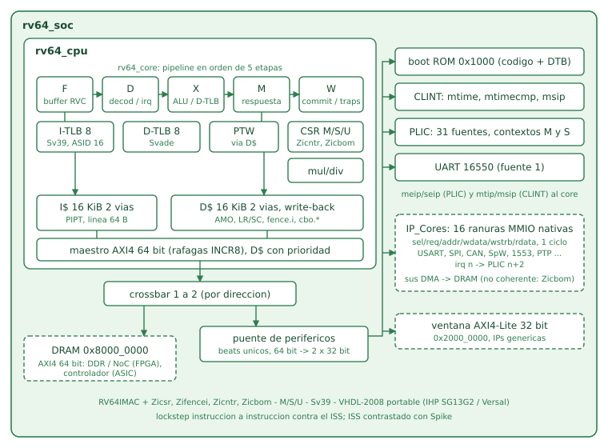

# RV64IMAC — Linux-Capable 64-bit RISC-V SoC for the IP_Cores family

A synthesizable RV64IMAC processor and SoC written in VHDL-2008, aimed at
production (ASIC on IHP SG13G2, prototype on AMD Versal). It runs OpenSBI and
an MMU Linux kernel, and it talks to the rest of the IP_Cores family over their
native one-cycle MMIO bus, unmodified. Every instruction is checked against an
independent Python ISS, and the ISS is itself checked against Spike.



---

## 1. What this is

The RV32IMA core in this repository boots nommu Linux on a multicycle,
cache-less datapath. This core is the production step: 64-bit, three privilege
levels, a real MMU, caches, a standard memory bus and an interrupt controller,
so that the IP_Cores can run under a regular Linux with drivers and DMA.

```
OpenSBI v1.6
Boot HART Base ISA          : rv64imac
Boot HART PMP Count         : 0
...
[    0.000000] Machine model: RV64IMAC SoC
[    0.000000] riscv-intc: 64 local interrupts mapped
[    0.000000] plic: interrupt-controller@c000000: mapped 31 interrupts with 1 handlers for 2 contexts.
[    0.015082] ASID allocator using 16 bits (65536 entries)
[    0.095163] cpu0: Ratio of byte access time to unaligned word access is 0.01, unaligned accesses are slow
[    0.493318] 10000000.serial: ttyS0 at MMIO 0x10000000 (irq = 2, base_baud = 6250000) is a 16550A
[    0.523165] Run /init as init process

*** RV64IMAC propio: Linux en espacio de usuario (/init) ***
init: el reloj avanza (clock_gettime OK)
```

This is the **RTL** SoC (boot ROM → OpenSBI 1.6 → Linux 6.6 → `/init`), run
in lockstep against the ISS: ~37 M retirements, every one identical (pc,
instruction, result, trap, memory write, interrupt lines). Simulated time is
0.52 s at 100 MHz; it took about 3 hours of simulation.

---

## 2. Feature summary

| Item | Value |
|------|-------|
| ISA | RV64IMAC + Zicsr, Zifencei, Zicntr, **Zicbom** |
| Privilege | M, S, U — Privileged Spec 1.12, `medeleg`/`mideleg`, MPRV/SUM/MXR, TVM/TW/TSR |
| MMU | Sv39, Svade (A/D faults), 16-bit ASIDs, 4 KiB / 2 MiB / 1 GiB pages |
| TLBs | I-TLB and D-TLB, 8 entries each, fully associative, round-robin |
| PTW | hardware, reads PTEs through the D$ (coherent with stores) |
| Pipeline | in-order, 5 stages (F/D/X/M/W), forwarding, precise traps committed in W |
| C extension | 4-halfword fetch buffer, 32-bit instructions across words and pages |
| M extension | iterative, no DSP: radix-4 multiply (32 cycles), radix-2 divide (64) |
| A extension | LR/SC with 64 B reservation granule, AMOs executed inside the D$ |
| I$ / D$ | 16 KiB, 2-way, 64 B lines, PIPT; D$ write-back + write-allocate |
| Bus | one AXI4 64-bit master (DRAM), INCR8 bursts for lines |
| Interrupts | CLINT (mtime/mtimecmp/msip) + PLIC (31 sources, M and S contexts) |
| Peripherals | 16550 UART, 4 KiB boot ROM with device tree |
| IP_Cores | 16 native MMIO slots (`sel/req/addr/wdata/wstrb/rdata`) + irq → PLIC 2..17 |
| Generic IP | AXI4-Lite 32-bit window (256 MiB) |
| DMA | non-coherent; managed by software with Zicbom (`dma-noncoherent`) |
| Synthesis (generic) | CPU without SRAMs: ~76 k cells, ~9 k flops, 0 latches |
| FPGA (VE2302) | 16.5 k LUT, 8 k FF, 8 BRAM36, 50 MHz with +2.28 ns slack |

---

## 3. Repository layout

```
SPEC_FREEZE_V1.md       frozen specification + v1.1 amendments (with reasons)
iss64.py                Python ISS, the oracle (RV64IMAC, M/S/U, Sv39, Zicbom)
compare.py              lockstep comparator, RTL trace vs ISS (core / cpu / soc)
compare_spike.py        ISS vs Spike comparator
lockstep_linux.py       OpenSBI + Linux on the RTL SoC in lockstep (trace through a FIFO)
mutate.py               mutation testing: every mutation must be killed
run_regression.sh       all layers in one command

rtl/rv64_pkg.vhd        types, decoder, RVC expander, ALU, PMAs
rtl/rv64_core.vhd       5-stage pipeline
rtl/rv64_csr.vhd        CSR file, traps, interrupt selection
rtl/rv64_muldiv.vhd     iterative M unit
rtl/rv64_mmu_pkg.vhd    Sv39 permission checks
rtl/rv64_tlb.vhd        fully associative TLB
rtl/rv64_ptw.vhd        page table walker
rtl/sram_1rw.vhd        single-port SRAM with bit mask (behavioural; macro in ASIC)
rtl/rv64_icache.vhd     I$
rtl/rv64_dcache.vhd     D$ (write-back, AMOs, fence.i clean, Zicbom)
rtl/rv64_axi_master.vhd shared AXI4 master
rtl/rv64_cpu.vhd        core + caches + AXI master
rtl/rv64_clint.vhd      CLINT
rtl/rv64_plic.vhd       PLIC
rtl/rv64_uart.vhd       16550 UART
rtl/rv64_periph.vhd     peripheral bridge: ROM, CLINT, PLIC, UART, IP_Cores MMIO, AXI4-Lite
rtl/rv64_soc.vhd        SoC top
rtl/rv64_bootrom_pkg.vhd  generated boot ROM (code + DTB)

tb/tb_rvc.vhd           layer 1: RVC expander, exhaustive (49 152 encodings)
tb/tb_muldiv.vhd        layer 1: M unit (13 728 vectors)
tb/tb_core.vhd          layers 2-3: core with ideal / random-latency memory
tb/tb_cpu.vhd           layer 3b: core + caches against a random-delay AXI4 slave
tb/tb_soc.vhd           layer 4: SoC from the boot ROM with the real IP_Cores USART + its DMA

sw/build_tests.sh       official riscv-tests (p and v environments) with clang/lld
sw/gen_*.py, sw/*.S     directed tests (CSR sweep, MMU, interrupts, caches, Zicbom, SoC)
sw/bootrom/             boot ROM sources and device tree
sw/linux/               kernel config fragment, /init, ISS boot script
```

---

## 4. Memory map and interfaces

| Address | Size | Contents |
|---------|------|----------|
| `0x0000_1000` | 4 KiB | boot ROM — reset vector: zeroes x1-x31, `a0`=hartid, `a1`=DTB, jumps to DRAM |
| `0x0200_0000` | 64 KiB | CLINT |
| `0x0C00_0000` | 64 MiB | PLIC |
| `0x1000_0000` | 4 KiB | UART 16550 (PLIC source 1) |
| `0x1001_0000` | 16 × 64 KiB | IP_Cores slot *n* at `0x1001_0000 + n·64 KiB`, irq *n* → PLIC source *n*+2 |
| `0x2000_0000` | 256 MiB | AXI4-Lite 32-bit window |
| `0x8000_0000` | up to 2 GiB | DRAM (cacheable, executable, atomics) |

Everything outside DRAM and the ROM is uncached, ordered and not executable.
Stores, AMOs and any non-idempotent access are only issued once nothing older
can still fault; idempotent DRAM loads may be issued speculatively.

### Connecting an IP_Core

Each slot exposes exactly the one-cycle bus the cores already use on the RV32
SoCs, so a core drops in without changes:

```vhdl
usart_u : entity work.usart_axi_top port map (
  clk => clk, aresetn => not rst, ddr_base => x"0080000000",
  sel => mm_sel(0), req => mm_req, addr => mm_addr(7 downto 0),
  wdata => mm_wdata, wstrb => mm_wstrb, rdata => mm_rdata(31 downto 0),
  irq_out => irq_ip(0),            -- PLIC source 2
  m_axi_... => ...);                -- its DMA, towards DRAM (outside the SoC)
```

Accesses of 1, 2 or 4 bytes become one bus cycle with the matching `wstrb`;
8-byte accesses become two (low word, then high word). The core DMA masters
reach DRAM through the platform interconnect (SmartConnect/NoC on Versal).
Because the D$ is write-back, that DMA is **not coherent**: Linux handles it
with Zicbom (`cbo.clean` before a device reads, `cbo.inval` after it writes),
announced in the device tree with `riscv,cbom-block-size = <64>` and
`dma-noncoherent`. `tb_soc` runs exactly this with the real USART DMA, and a
negative control (no `cbo.clean`) fails as it should.

---

## 5. Verification methodology

Same rule as RV32IMA: every layer has a bit-exact pass criterion, and every
layer ships with mutations that must fail.

**Layer 0 — the oracle.** `iss64.py` was written before the RTL. It passes
the official riscv-tests (195/198; the three exceptions are required by the
frozen spec: no PMP entries and trapping misaligned accesses), and it is
compared instruction by instruction with Spike on 196 programs, including all
81 Sv39 `v`-environment tests, a 464 k-instruction sweep of the 4096 CSR
addresses in M, S and U, a 9 k-instruction MMU stress and the Zicbom test. The
remaining Spike differences are all legal implementation choices and are
listed in the spec (§12).

**Layer 1 — units.** RVC expander against the ISS on all 49 152 16-bit
encodings; M unit on 13 728 corner and random vectors.

**Layer 2 — lockstep, ideal memory.** Each retirement is compared: PC,
instruction bits, destination register and value, trap cause and `tval`, and
the address, byte lanes and data of every store. Interrupts are dictated by
the RTL, but each one is checked for **legality** (pending and enabled in the
ISS, highest priority) and **liveness** (no enabled interrupt left pending for
more than 24 retirements), using the `mip` lines the RTL saw.

**Layer 3 — random latency.** The same, with random `ready` and 1-12 cycle
latencies on both memory ports.

**Layer 3b — caches.** Core + I$ + D$ + AXI4 against a slave with random
delays on all five channels, plus a cache stress test (4× the D$, 1.5× the
I$, self-modifying code with `fence.i`, AMO/LR/SC on lines being evicted).

**Layer 4 — SoC.** Boot from the ROM, the real IP_Cores USART on slot 0 with
its interrupt through the PLIC, AXI4-Lite with AW and W on different cycles,
the USART DMA with Zicbom, and OpenSBI + Linux in lockstep against the ISS.

**Directed tests.** CSR sweep (all 4096 addresses, WARL patterns, privilege
checks), interrupt storm (M timer → S timer injection, MSI, mixed payload),
M-mode interrupts with WFI and vectored `mtvec`, timer-vs-`mtimecmp` races
(the interrupt-replay path), MMU (superpages, SUM/MXR/MPRV, U, ASIDs, A/D,
misaligned superpages, reserved bits), Zicbom gating and faults, AMOs and
LR/SC on both 32-bit lanes, and at SoC level the real CLINT (`soc_timer`) and
the PLIC S context (`soc_plic`).

### Results (see `run_regression.sh`)

| Layer | Result |
|-------|--------|
| ISS vs riscv-tests | 195/198 (3 waived by the spec: no PMP, misaligned accesses trap) |
| ISS vs Spike | 199/199 programs identical (incl. CoreMark, 4.2 M instr.) |
| RVC expander | 49 152/49 152 |
| M unit | 13 728/13 728 |
| Lockstep, ideal memory | 199/199 + directed tests + interrupt storm |
| Lockstep, random latency | 6 configurations × 200/200 |
| Caches + AXI4 | all riscv-tests + cache stress (386 k retirements) |
| SoC | USART + PLIC, DMA + Zicbom, riscv-tests from the boot ROM |
| SoC | + real CLINT timer (`soc_timer`), PLIC S context (`soc_plic`) |
| CoreMark (lockstep, caches + AXI4) | CRCs correct, identical to the ISS; ≈1.07 CoreMark/MHz |
| OpenSBI + Linux on the RTL SoC | boot ROM → `/init`, ~37 M identical retirements |
| Mutations | 30/30 killed (8 core, 8 MMU, 14 caches/AXI/SoC) |

---

## 6. Bugs worth documenting

**A load stalled in M, its consumer already in X.** With ideal memory the
load-use stall in D always covers the dependency. With wait states the load
waits in M, the consumer enters X behind it and forwards `exmem.res` — the
address, not the data. Found by layer 3 on the first random-latency run. The
fix makes X wait until the load reaches W instead of forwarding straight from
the bus response, which would have put the bus on the ALU path.

**Requests during reset.** The core asked for an instruction while still in
reset; the memory accepted it, and its response arrived after reset as if it
were the first fetch. The riscv-tests start with a jump and hid it.

**The verification had holes, not only the RTL.** The first mutation round
left four survivors. The worst: in lockstep the ISS takes interrupts when the
RTL says so, so an illegal or missing interrupt went unnoticed. Hence the
legality and liveness checks and the `mip` field in the trace. Another
survivor (a `c.j` offset bit) is only caught by the exhaustive layer 1, so
mutations now also run the unit benches.

**`mtimecmp` decoded at the wrong offset.** The CLINT compared `addr(15:3)`
with `"1000000000000"` (0x8000) instead of `"0100000000000"` (0x4000), so every
write to `mtimecmp` was lost and MTIP never rose. OpenSBI and Linux ran
13 M identical retirements up to `check_unaligned_access`, the first place
where the kernel waits for a jiffy, and spun there forever. The lockstep could
not see it: MTIP came from the RTL and CLINT loads were copied from the RTL as
non-deterministic, and the interrupt tests run on the testbench CLINT, not the
SoC one. Now the ISS models `mtimecmp`/`msip` and checks the RTL's MTIP/MSIP on
every retirement with zero slack (only `mtime` reads are copied), and
`soc_timer` exercises the SoC CLINT on the OpenSBI path (MTI → STIP → S).
Two mutations (`0x8000`, and `>` for `>=`) guard it.

**Two more holes found by mutation.** "AMO on lane 0" survived because every
riscv-test puts the AMO operand at offset 0 (`amo_lanes` now hits both 32-bit
lanes); "7-beat write burst" survived because the testbench AXI slaves trusted
`wlast` and ignored `awlen` (they now assert the AXI rule). Neither was an RTL
bug, but either would have hidden one. The PLIC S context, the one Linux uses,
had no SoC-level test either: `soc_plic` (delegated SEI, claim/complete at
0x201004, threshold, read-back) plus two mutations.

**OpenSBI reading an empty UART FIFO.** The Linux lockstep stopped inside
`uart8250_init`: reading RBR with an empty FIFO returned an uninitialised
entry. Harmless in silicon, non-deterministic in principle; the UART now
returns 0.

---

## 7. Status and honest limitations

- **Done and verified in simulation:** Pasos 0-7 of the spec and the Zicbom
  amendment. OpenSBI + Linux to `/init` on the RTL SoC, in lockstep with the ISS.
- **Running on silicon (TE0950, Versal VE2302, 50 MHz):** Vivado 2025.2.1
  implementation with CIPS + NoC + LPDDR4 meets timing (WNS +2.28 ns, 16.5 k LUT,
  8 BRAM36). `board_smoke` passes on the board (M, A, 64 KiB through the D$ to
  LPDDR4, CLINT) and its loop takes 900 013 cycles, exactly the RTL simulation
  figure. OpenSBI 1.6 + Linux 6.6 boot to `/init` in 1.3 s, loaded by the A72
  with `fpga/rv64_load`. Not an ASIC: timing on IHP SG13G2 is still unknown.
- **No PMP:** OpenSBI is not isolated from S-mode. Acceptable for a prototype,
  not for a secure product. Planned for v2.
- **No Debug Module:** a fabricated chip could only be debugged through the
  UART and the boot ROM. It should go in before any tapeout.
- **Performance:** single-issue, static not-taken prediction, iterative M
  unit, one outstanding AXI transaction. Correctness first. CoreMark (10
  iterations, clang 18 -O2, run in lockstep on the CPU with caches + AXI4):
  9.34 M cycles in the timed region → **≈1.07 CoreMark/MHz**, CPI ≈ 2.2, almost
  unchanged with 12-cycle random AXI latency (the caches hold the working set).
  Where the cycles go: ~95 k `mul` at ~33 cycles ≈ 3.1 M (a third), ~417 k
  taken branches/jumps at 2-3 bubbles ≈ 1 M. A radix-16 or pipelined
  multiplier and a small BHT/BTB are the two levers for v2 (est. ~1.5-1.8).
- **Reset:** synchronous everywhere; needs an external deassert synchronizer.
  Some datapath registers have reset (area, not correctness).

---

## 8. Building and running

```bash
# tools: ghdl-llvm 4.x, clang + lld + llvm 18, python3, dtc; optional: spike in PATH
# lives in IP_Cores/RV64IMAC: sim/build.sh picks the USART from ../USART, nothing to configure
export RISCV_TESTS=~/riscv-tests          # git clone --recursive .../riscv-tests
./run_regression.sh rapida                # builds everything, layers 0-4 (~30 min)
./run_regression.sh                       # full, with the 30 mutations (hours)

python3 compare.py --tb soc sw/soc_dma    # one test, SoC level
python3 sw/linux/boot_iss.py --sbi fw_jump.bin --kernel Image --ram-mb 128
python3 lockstep_linux.py --sbi fw_jump.bin --kernel Image
COREMARK=~/coremark sw/coremark/build.sh  # optional; layer 0 compares it with Spike
```

OpenSBI v1.6: `make LLVM=1 PLATFORM=generic FW_TEXT_START=0x80000000
FW_JUMP=y FW_JUMP_ADDR=0x80200000 FW_JUMP_FDT_ADDR=0x82200000`.
Linux 6.6: `sw/linux/build_linux.sh <linux> <out>` (tinyconfig + fragment).

---

## 9. License

MIT
